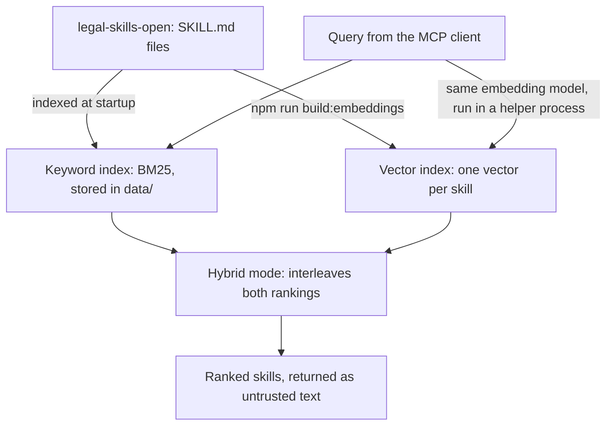

# legal-skills-mcp

An MCP server that lets an AI assistant search open legal skills by keyword, by meaning, or both.

[](https://github.com/T-Celor/legal-skills-mcp/stargazers)
[](LICENSE)
[](https://nodejs.org)
[](https://modelcontextprotocol.io)

legal-skills-mcp connects an assistant such as Claude to [legal-skills-open](https://github.com/ThomasMoreAI/legal-skills-open), a library of 20,293 legal skills in `SKILL.md` format, so that the assistant can work from the templates, procedures and checklists that already exist for a task.

> [!WARNING]
> Disclaimer: results are not legal advice. The skills are written by third parties, and this project does not guarantee their legal quality. Check each point against official sources, and consult a lawyer for any important matter.

## Table of contents

- [Overview](#overview)
- [Features](#features)
- [How it works](#how-it-works)
- [Search modes](#search-modes)
- [Skills](#skills)
- [The library at a glance](#the-library-at-a-glance)
- [Quick start](#quick-start)
- [Usage](#usage)
- [Results](#results)
- [Memory](#memory)
- [Limitations](#limitations)
- [Configuration](#configuration)
- [Development](#development)
- [Security and privacy](#security-and-privacy)
- [Roadmap](#roadmap)
- [Contributing](#contributing)
- [License and third-party licenses](#license-and-third-party-licenses)
- [Acknowledgements](#acknowledgements)

## Overview

The [Model Context Protocol](https://modelcontextprotocol.io) (MCP) lets an assistant call tools that run outside it. legal-skills-mcp is one such server: it runs as a local process and talks to the MCP client, such as Claude Code, over stdio. The library it searches, legal-skills-open, is published by ThomasMoreAI. The server retrieves skills and drafts nothing itself. The current version is 0.3.0.

It is meant for:

- Lawyers who want their assistant to start from written procedures for a given jurisdiction.
- Legal-tech teams that want to check what the library covers by country, practice area and language.
- Developers who need a local, read-only source of legal skills, or an example of hybrid keyword and semantic search.

It finds the skills closest to a request, even when they share no words with the query, and can limit the search to one jurisdiction, language, practice area or tag.

## Features

- Three read-only MCP tools: search, full skill retrieval and facet counts.
- Keyword (BM25) search by default, plus semantic search and hybrid search, which interleaves the two.
- Filters for jurisdiction, language, practice area and tag, and presets, including `method`, which covers method skills in every language.
- Cross-language matching through a multilingual model and a hand-written glossary of 19 legal concepts.
- No request to an external service once the model is downloaded.
- Third-party text marked as untrusted, and bundled scripts never executed.
- A keyword index in SQLite, rebuilt when a skill file changes. Only the index stays in memory: skill texts are read from disk when they are requested.

## How it works



The server keeps two indexes of the library.

The keyword index ranks skills with BM25, a standard formula for text search. Fields have different weights: title 3, name and tags 2, description 2, and the first 6,000 characters of the body 1. Accents are ignored, and German umlauts match in both spellings, so "Gebühren" also matches "Gebuehren". A hand-written glossary links 19 legal concepts across languages: a query with "réclamation" also looks for "complaint", "Beschwerde" and "reclamação", and these equivalents count for half. The index is stored in `data/legal-skills.sqlite` (about 125 MB) and rebuilt when a skill file changes size or modification time. Postings are read from that file for each query, with a page cache of 16 MB, and a skill's text is read from the library only when `get_legal_skill` asks for it.

The vector index holds one 384-dimension vector per skill, computed from its title, description and tags. A vector is a list of numbers that describes the meaning of a text. The model is intfloat/multilingual-e5-small in its 8-bit ONNX form (Xenova/multilingual-e5-small), run locally through transformers.js and ONNX Runtime. Each query goes through the same model and is compared with the stored vectors. `npm run build:embeddings` computes the vectors once and stores them in a 31 MB file, which is loaded on the first semantic or hybrid search. The model runs in a helper process that starts on that first search and exits after a minute without searches, so its memory goes back to the system.

Hybrid mode takes the best keyword result and the best semantic result in turn, and skips duplicates. When keyword search finds a match, its best result ranks first and the best semantic result second.

## Search modes

| Mode | Ranking |
| --- | --- |
| `keyword` (default) | Ranks skills by the words of the query, with BM25 and the glossary. Needs no model |
| `hybrid` | Alternates the best keyword result and the best semantic result, without duplicates. Starts the model in a helper process |
| `semantic` | Ranks skills by the meaning of the query, with the vector index. Starts the model in a helper process |

## Skills

In this project, a skill is a set of written instructions for one legal task, such as writing a consumer complaint letter or reviewing an employment contract. Each skill is a Markdown file named `SKILL.md`: a YAML frontmatter header with metadata, then the text that guides the assistant through the task. Some skills also come with supporting files, scripts included.

The library groups skills by country, then by practice area:

```text
{country}/{practice}/skills/{slug}/SKILL.md
```

A skill's id follows the same pattern, for example `fr/contracts/skills/<slug>`. The main frontmatter fields are:

| Field | Content |
| --- | --- |
| `name` | The skill's name |
| `description` | A short summary of what the skill does |
| `license` | The skill's own license |
| `jurisdiction` | A jurisdiction code, such as `fr`, `de`, `eu` or `general` |
| `practice` | The practice area, also called theme, such as `consumer`, `employment` or `contracts` |
| `language` | A language code, such as `en`, `fr`, `de` or `zh` |
| `tags` | Task types or topics, such as `drafting` or `litigation`; most skills have none |

The server never executes scripts bundled with a skill; `get_legal_skill` only lists them.

## The library at a glance

| Measure | Value |
| --- | --- |
| Skills | 20,293 |
| Jurisdiction codes | 74 |
| Practice areas (themes) | 48 |
| Languages | 20 |
| Skills with at least one tag | 733, about 3.6% |
| Most frequent tags | `drafting` 407, `agreement` 194, `transactional` 168, `litigation` 110 |

Coverage by language is very uneven:

| Language | Skills |
| --- | --- |
| German | 15,210 (75%) |
| English | 3,736 (18%) |
| Spanish | 471 |
| Portuguese | 294 |
| Chinese | 245 |
| French | 109 (0.5%) |
| Turkish | 69 |
| Italian | 65 |

## Quick start

You need Node.js 22 or later and Git.

```bash
git clone --recurse-submodules https://github.com/T-Celor/legal-skills-mcp.git
cd legal-skills-mcp
npm install
npm run build
npm run build:embeddings
```

The `--recurse-submodules` flag also fetches legal-skills-open, which the server reads from `vendor/legal-skills-open` by default.

> [!NOTE]
> The first run of `npm run build:embeddings` downloads the model, about 118 MB, and takes about 11 minutes.

In Claude Code, open the project folder. The `.mcp.json` file at its root declares the server as `legal-skills`, started with `node --max-semi-space-size=1 dist/index.js`, and Claude Code asks you to approve it the first time. Check the connection with:

```bash
claude mcp list
```

`legal-skills` should appear as connected. Other MCP clients can start the same command from the repository folder. The flag keeps memory low (see [Memory](#memory)).

The keyword index is built the first time the server starts, which takes about three minutes. `npm run build:index` builds it ahead of time.

## Usage

The server exposes three tools, all read-only:

| Tool | Purpose | Main arguments |
| --- | --- | --- |
| `search_legal_skills` | Finds skills by keyword, by meaning, or both | `query`; optional `preset` (`method` or `french-general`), `jurisdiction`, `language`, `practice`, `tag`; `limit` from 1 to 25 (default 8); `mode`: `keyword` (default), `hybrid` or `semantic` |
| `get_legal_skill` | Returns the full `SKILL.md`, up to 200,000 characters, and the list of supporting files | `id`, as returned by a search |
| `list_legal_facets` | Counts skills per language, jurisdiction, practice and tag | Optional filters |

An assistant can start with `list_legal_facets` to see what exists for a language or jurisdiction, search with `search_legal_skills`, then read one result with `get_legal_skill`. Filter values are lowercase, such as `fr`, `zh` or `employment`, and `list_legal_facets` shows the values in use.

Example arguments for `search_legal_skills`:

```json
{
  "query": "rupture du contrat de travail par l'employeur",
  "jurisdiction": "fr",
  "language": "fr",
  "limit": 4,
  "mode": "hybrid"
}
```

### Choosing filters

Filters combine with AND, so each filter you add narrows the results. Explicit filters override the values a preset sets. Call `list_legal_facets` with the same explicit filters to see how many skills remain.

- For a topic question in French, start with `"language": "fr"` (109 skills). Add `"jurisdiction": "fr"` (127 skills, or 65 when combined with French) only when the question concerns France.
- For a method question, in any language, use `"preset": "method"`. It selects the general practice area: 2,165 skills in every country and language, such as research methods, workflows and quality checks. Leave `practice` empty for topic searches.
- The preset `"french-general"` sets `"jurisdiction": "fr"`, `"practice": "general"` and `"language": "fr"`. It matches 12 French method skills, and it leaves out skills whose jurisdiction is `general`, such as *Complaint Letter Writer*, the top result for "réclamation consommateur". Use it when you need French method skills specifically.

## Results

Four of the six queries tested are shown. Each was run in keyword mode and in hybrid mode on the full library, and the top 4 results were compared.

| Query | Keyword mode | Hybrid mode | Takeaway |
| --- | --- | --- | --- |
| "réclamation consommateur" (consumer complaint) | "Complaint Letter Writer" first | Same first result; "Digital Consumer Claims Triage" joins the top 4 | Hybrid adds a consumer-claims skill |
| "Beschwerde gegen eine Bank wegen unberechtigter Gebühren" (complaint against a bank over unjustified fees) | No Bundesnetzagentur or ombudsman skill in the top 4 | The Bundesnetzagentur complaint skill and a German ombudsman and BaFin skill join the top 4 | Better, but still weak overall |
| "rupture du contrat de travail par l'employeur" (termination of employment by the employer) | Four French employment skills | The same four skills | No change |
| "保密协议审查" (confidentiality agreement review) | "/review" first, the exact-title skill second, "/customize" in the top 4 | Same first two; a Chinese contract-review skill replaces "/customize" | A generic result gives way to a contract-review skill |

Across all six queries tested, hybrid mode never lowered the first result and improved the top 4 for three of them.

### Method search in any language

With the `method` preset, a question about method finds method skills whatever language it is written in. Each query below was run with `"preset": "method"` and `"mode": "hybrid"`.

| Query | Top results |
| --- | --- |
| "step by step method for legal research" | Legal Research Methodology; Legal Research Guide; Legal Research |
| "Methode fuer juristische Recherche" | Rechercher le droit applicable (French); German skills on legal methodology |
| "how to check a legal deliverable before sending it" | Deliverable Fidelity EN; Output scoring - a scorecard before you send |

Measured on Windows 11 with the full library, in one session:

| Step | Time |
| --- | --- |
| Connection, with the index in place | About 0.6 s |
| First keyword search | About 2.1 s |
| First hybrid search, which starts the model and loads the vectors | About 2.2 s |
| Later searches | About 0.1 to 0.2 s |
| Building the index, on first start or after the library changes | About 160 s, measured once |

## Memory

The server keeps the index in memory, not the skill texts. Figures are the private memory of each process, measured on Windows 11 with the full library:

| Process | Memory |
| --- | --- |
| Server, keyword search | About 110 to 145 MB |
| Server, after a hybrid or semantic search | About 170 MB |
| Embedding helper, while the model runs | About 480 MB |

The helper exits after a minute without semantic searches, and the server then returns to its keyword figure. The start command passes `--max-semi-space-size=1` to Node. Without that option, V8 kept roughly 120 MB of heap reserved after indexing, and the server measured about 285 MB.

## Limitations

- The embedding model is light and sometimes returns off-topic results for vague queries.
- Tags cover about 3.6% of the library, so the tag filter is partial.
- French is under-represented, with 109 skills. For French questions, start with the language filter (see [Choosing filters](#choosing-filters)).
- The German query on bank fees stays weak, even in hybrid mode.
- The glossary is written by hand and does not cover all of law.
- Building the index takes about three minutes on first start or after the library changes. A client with a 60-second timeout may report an error on that first call. The build continues on the server, so a retry works once it is ready.
- Results are not legal advice, and the project does not guarantee the legal quality of third-party skills.

## Configuration

The server reads two optional environment variables:

| Variable | Purpose | Default |
| --- | --- | --- |
| `LEGAL_SKILLS_DIR` | Folder of the skill library | `vendor/legal-skills-open` |
| `LEGAL_SKILLS_DATA` | Folder of the indexes | `data/` |

The start command, in `package.json` and `.mcp.json`, passes `--max-semi-space-size=1` to Node. See [Memory](#memory).

## Development

The server is written in TypeScript. Its main dependencies are `@modelcontextprotocol/sdk`, `@huggingface/transformers`, `yaml` and `zod`.

| Command | What it does |
| --- | --- |
| `npm run build` | Compiles the TypeScript sources into `dist/` |
| `npm run typecheck` | Checks types without writing files |
| `npm test` | Builds, then runs the tests with the Node.js test runner |
| `npm run build:index` | Builds, then builds the keyword index |
| `npm run build:embeddings` | Builds, then computes the vector index |
| `npm start` | Starts the server over stdio |

Project layout:

```text
src/index.ts             stdio entry point
src/server.ts            the three tools
src/store.ts             SQLite index: keyword ranking, facets, skill reads
src/catalog.ts           finding, indexing and fingerprinting SKILL.md files
src/glossary.ts          cross-language concepts
src/text.ts              tokenisation
src/semantic.ts          vectors, similarity, interleaving
src/embedder.ts          the transformers.js model, and the helper process that runs it
src/embed-protocol.ts    requests and replies between the server and the helper
src/embed-worker.ts      the helper process
src/build-index.ts       builds the keyword index
src/build-embeddings.ts  builds the vector index
src/labels.ts            language names
```

To run the tests:

```bash
npm test
```

The 75 automated tests cover indexing, the SQLite index and its rebuilds, the glossary, the MCP protocol, the stdio entry point, hybrid search, the embedding helper and filter presets. They also use the real library when the submodule is present.

## Security and privacy

- Once the model is downloaded, the server sends no request to an external service.
- Results reach the assistant's model like any other tool output.
- Third-party skill text is returned marked as untrusted, inside a random boundary that changes with each response.
- Bundled scripts are never executed.
- Symbolic links are never followed, and YAML aliases are refused.
- Skill ids are looked up in an index and never used as file paths.

## Roadmap

Ideas for later versions, open to discussion:

- Try a larger multilingual embedding model, or one trained on legal text, to reduce off-topic results.
- Reduce the helper's memory, which is the largest part of the footprint while semantic search runs.
- Extend the glossary beyond its 19 concepts, starting with weak topics such as bank fees.
- Build a larger set of test queries with expected results, so that ranking changes can be measured.
- Propose tags for untagged skills to legal-skills-open, so that the tag filter covers more of the library.

## Contributing

Bug reports and pull requests are welcome on [GitHub](https://github.com/T-Celor/legal-skills-mcp/issues). Please run `npm run typecheck` and `npm test` before opening a pull request. Changes to the skills themselves belong in [legal-skills-open](https://github.com/ThomasMoreAI/legal-skills-open).

## License and third-party licenses

| Component | License |
| --- | --- |
| legal-skills-mcp (this repository) | MIT, see [LICENSE](LICENSE) |
| [legal-skills-open](https://github.com/ThomasMoreAI/legal-skills-open) | Apache-2.0 |
| Each skill | Its own license, in the `license` field of its frontmatter |
| [intfloat/multilingual-e5-small](https://huggingface.co/intfloat/multilingual-e5-small), the upstream model | MIT |
| [Xenova/multilingual-e5-small](https://huggingface.co/Xenova/multilingual-e5-small), its ONNX conversion | No license of its own declared |

Check a skill's license before you redistribute it.

## Acknowledgements

- [ThomasMoreAI](https://github.com/ThomasMoreAI) for legal-skills-open.
- intfloat for multilingual-e5-small, and Xenova for its ONNX conversion.
- The maintainers of the MCP TypeScript SDK, transformers.js, ONNX Runtime, yaml and zod.
